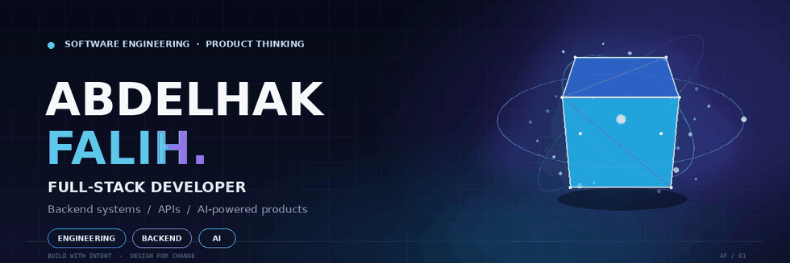
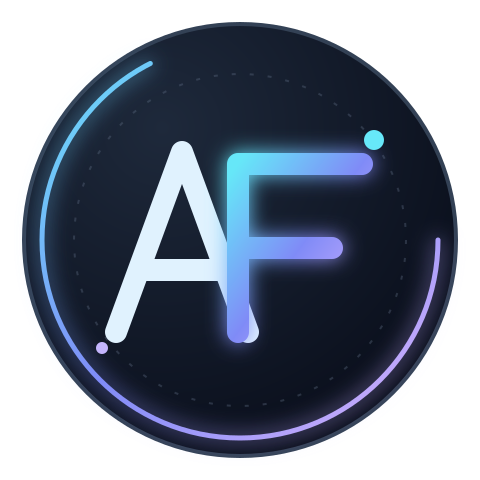
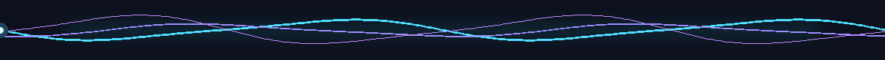
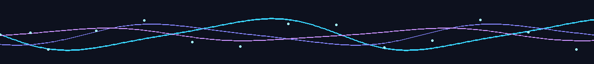

<!--
  PROFILE README — abdelhakF
  Keep the assets/ directory alongside this file when uploading to GitHub.
  The hero, morphing dividers and footer are optimized GIFs; the AF logo is supplied as PNG plus an editable SVG master.
-->

  

  

  
  
  

  <em>“Good software is not just built to work. It is designed to evolve.”</em>

  <a href="#01-about-me">ABOUT</a> &nbsp;·&nbsp;
  <a href="#02-engineering-toolkit">TOOLKIT</a> &nbsp;·&nbsp;
  <a href="#03-selected-work">SELECTED WORK</a> &nbsp;·&nbsp;
  <a href="#04-github-activity">ACTIVITY</a> &nbsp;·&nbsp;
  <a href="#06-lets-connect">CONNECT</a>

  

## 01 About me

I'm **Abdelhak Falih**, a Full-Stack Developer and an IT student at **Institut Supérieur du Génie Appliqué (IGA)**. I enjoy engineering complete products: from shaping an interface and designing a data model to building APIs, integrating services, and connecting the whole system into a coherent experience.

My strongest interests sit at the intersection of **backend engineering, software architecture, API development, and applied AI**. I care about the decisions behind the code: clear boundaries, predictable behaviour, secure integrations, useful abstractions, and systems that remain understandable as they grow.

<table>
  <tr>
    <td width="50%" valign="top">
      <strong>⌘ Engineering mindset</strong> 
      I value maintainability, readable code, thoughtful architecture, useful documentation, and practical problem-solving.
    </td>
    <td width="50%" valign="top">
      <strong>◈ Product mindset</strong> 
      I aim to connect user needs, interface design, backend logic, and data into products that solve real problems.
    </td>
  </tr>
  <tr>
    <td width="50%" valign="top">
      <strong>⬡ Areas I work across</strong> 
      Full-Stack Web · Backend Systems · REST APIs · Databases · Mobile Applications.
    </td>
    <td width="50%" valign="top">
      <strong>✳ What I explore</strong> 
      AI Engineering · Generative AI · RAG · System Design · Scalable Application Architecture.
    </td>
  </tr>
</table>

  

## 02 Engineering toolkit

A curated view of the technologies I use and explore across frontend, backend, mobile, data, and development workflows.

### Frontend & experience

  

### Backend & APIs

  

### Mobile engineering

  

### Databases & persistence

  

### Tooling & delivery

  

### AI integration & workflow tools

  
  
  
  
  
  
  
  

  
  
  

  

## 03 Selected work

A selection of public repositories. Each project represents a different engineering challenge, from multi-tenant SaaS and AI-assisted learning to secure web applications and client-server systems.

<table>
  <tr>
    <td width="50%" valign="top">
      <h3><a href="https://github.com/abdelhakF/brain-agent">01 · Brain Agent ↗</a></h3>
      <strong>Multi-tenant conversational commerce SaaS</strong>  
      A unified workspace for customer conversations across messaging channels, with tenant-aware AI assistance, lead management, and commerce integrations.
        
      <strong>STACK</strong> · TypeScript · Node.js · Express · React · PostgreSQL · Drizzle ORM · Flowise · Docker
    </td>
    <td width="50%" valign="top">
      <h3><a href="https://github.com/abdelhakF/SmartLearn">02 · SmartLearn IA ↗</a></h3>
      <strong>AI-assisted learning platform</strong>  
      An educational platform concept built around course resources, retrieval-augmented question answering, and learning support for students and teachers.
        
      <strong>STACK</strong> · Python · FastAPI · PostgreSQL · pgvector · LlamaIndex · React · Vite · Tailwind CSS
    </td>
  </tr>
  <tr>
    <td width="50%" valign="top">
      <h3><a href="https://github.com/abdelhakF/Minilinkedin">03 · Mini LinkedIn ↗</a></h3>
      <strong>University professional network</strong>  
      A university-oriented social platform with profiles, posts, connections, messaging, notifications, and academic or internship opportunities.
        
      <strong>STACK</strong> · Java · Spring Boot · Spring Security · JWT · React · PostgreSQL · Hibernate/JPA · Swagger
    </td>
    <td width="50%" valign="top">
      <h3><a href="https://github.com/abdelhakF/SportTicket">04 · SportTicket ↗</a></h3>
      <strong>Client-server event ticketing system</strong>  
      A Java client-server application for browsing sporting events, reserving seats, managing tickets, and persisting data through a relational database.
        
      <strong>STACK</strong> · Java · Java RMI · JavaFX · JDBC · PostgreSQL
    </td>
  </tr>
</table>

  
<strong>05 · CM-Compaliom-2030 — Conversational assistant project</strong>

   
  An academic conversational assistant concept for World Cup 2030 supporters. The repository brings together a chat interface and an AI workflow using retrieval-oriented components. The project documentation indicates that the frontend-to-webhook integration is still a work in progress.
    
  <strong>STACK</strong> · React · TypeScript · Vite · Tailwind CSS · n8n · Groq · Pinecone · Hugging Face
    
  <a href="https://github.com/abdelhakF/CM-Compaliom-2030">Explore repository ↗</a>

  

## 04 GitHub activity

  
  

  

  

Statistics are generated by external services and may occasionally be unavailable or delayed. Language proportions reflect repository contents, not necessarily proficiency.

  

## 05 Currently exploring

| Direction | Topics |
| --- | --- |
| **Software architecture** | Modular architecture, separation of concerns, system design, maintainability, and scalability. |
| **Backend engineering** | API security, authentication, authorization, performance, testing, and integration patterns. |
| **AI engineering** | LLM integration, retrieval-augmented generation, agent workflows, and reliable AI features. |
| **Data engineering** | Relational data modeling, indexing, query efficiency, and vector search. |
| **Mobile development** | Cross-platform application development with Flutter and Dart. |

  

## 06 Let's connect

I'm interested in thoughtful engineering, useful products, open-source collaboration, and conversations about backend systems, application architecture, and applied AI.

  
  

  LinkedIn: replace <code>YOUR-LINKEDIN-HANDLE</code> with your real profile slug · Email: add your preferred professional address when ready.

  <strong>Think clearly. Build deliberately. Keep making it better.</strong>

  

  Designed with intention · Engineered to evolve · <a href="https://github.com/abdelhakF">@abdelhakF</a>

